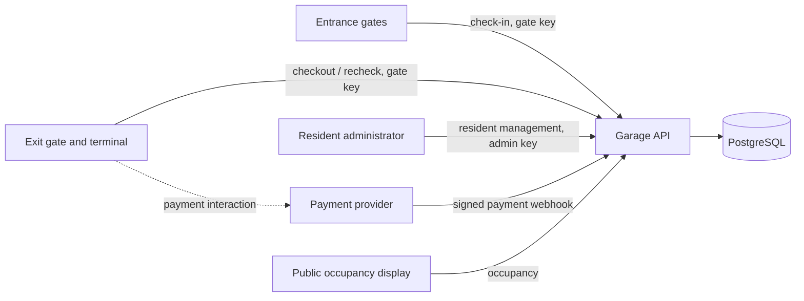

# Garage application: pilot architecture

## Status and purpose

This is a cross-feature design for the pilot, not an implementation specification or a description of completed business functionality. It records decisions made during planning on 2026-11-08, alongside assumptions, limitations and unresolved details. `BRIEF.md`, `docs/gates.md` and `docs/payment-provider.md` remain the supplied sources; this document does not change what the vendors have actually promised.

The foundation currently provides an Express app, configuration and database tooling; its business schema is empty and its parking endpoints are not implemented. The configured stack is TypeScript, Node 26, Express, PostgreSQL, Drizzle ORM and `pg`, with Vitest and Docker Compose for testing and local development. This architecture builds on that foundation rather than introducing additional services.

**Spec-first checkpoint:** PB-03 through PB-06 each require a reviewed feature spec in `specs/` committed before the corresponding implementation. Ask for explicit authorization before committing. The architecture does not replace those specs; substantive changes to a feature spec also need the spec-first checkpoint.

## Context and boundaries

The brief specifies pilot building `PB-AMS-2M8D`, two entrance gates, two exit gates, a public occupancy display and a payment provider. Future buildings may have different layouts and tariffs. Support for multiple buildings and their administration is not implied by accommodating building-specific data.



The final payment-interaction connection is illustrative: the supplied material does not specify the terminal-to-provider protocol. The gate calls only the garage system for the parking and exit decision. The payment provider sends its result to the garage system, not to the gate through an assumed integration.

### Responsibilities

One modular application is recommended, with boundaries around:

- **API and security:** request validation, gate/admin authentication, raw-body webhook verification and HTTP responses.
- **Resident registry:** plate registration and removal, administrative listing, capacity and resident eligibility.
- **Parking:** space allocation, session lifecycle and exit authorization.
- **Pricing:** elapsed-time started hours, Amsterdam calendar-day caps and amounts due.
- **Payments:** provider confirmations, attempt identity, deduplication and recorded amounts paid.
- **Occupancy:** public space status without plates or other unnecessary private information.
- **Persistence:** transactional state and database-enforced safety where applicable.

These are logical responsibilities, not mandated services or directory layout. PostgreSQL is the shared source of truth. No message broker or separate payment service is required by this design.

## Pilot layout and eligibility

| Spaces | Floor | Eligibility | Tariff |
| --- | --- | --- | --- |
| 1–50 | 1 | Registered residents, car or motorcycle | Free |
| 51–75 | 1 | Visitor cars | €5 per started hour, €30 daily cap |
| 76–130 | 2 | Visitor cars | €5 per started hour, €30 daily cap |
| 131–150 | 2 | Visitor motorcycles | €3 per started hour, €18 daily cap |

The pilot registry holds at most 50 registered plates. Normalize case and remove spaces and dashes, so `AB-123-C`, `ab123c` and `AB 123 C` match. Exact allowed characters and validation limits remain for the feature spec.

| Registered plate? | Driver selection | Outcome |
| --- | --- | --- |
| Yes | Resident or visitor | Free resident space, for either vehicle type |
| No | Resident | Reject the claim; driver can correct the plate or retry as a visitor |
| No | Visitor | Paid space for the vehicle type |

Reject a second active session for the same normalized plate. The session's actual category is determined at check-in: adding a plate to the registry later does not make an existing visitor session free. This is a deliberate simplification and limitation. Checkout's required `isResident` field is non-authoritative: a mismatch does not change the recorded category or reject checkout. The registry contains no resident profile, but licence plates can still be personal data and require protection.

An admin API, protected with its own generated key, registers and removes plates and lists registered plates. Prevent removal during an active resident session. The limit, active-session rule and allocation must remain correct under concurrent requests. Together these rules protect *recorded* resident capacity, not physical availability: the exit approximation below can diverge from reality. Exact admin routes, capacity enforcement and error behavior remain to be specified.

## Check-in and occupancy

An authenticated entrance gate submits the brief's check-in request with `X-Request-Id`. The system validates it, resolves eligibility, and allocates an eligible space and creates a session atomically. Concurrent successful requests must never allocate the same space; protect this with PostgreSQL-enforced invariants and appropriate transactions, not only in-memory locks. A retry of a successful check-in must not allocate another space.

Occupancy is publicly readable and reflects **recorded allocation**. It must not disclose plates or payment information. How to represent resident and vehicle-category eligibility in the response is to be specified in PB-06. On exit authorization, the system releases the recorded space, assuming the vehicle leaves. It cannot verify that the barrier actually opened or the vehicle departed; actual occupancy can therefore differ.

## Exit and payment flow

The brief and gate notes do not fully specify how a gate receives an asynchronous payment result. For this pilot, the following is an **assumed gate contract**, not a confirmed vendor capability:

- The gate is the terminal/controller; the barrier is the physical mechanism. A `200` exit authorization causes the gate to open the barrier.
- The gate can handle `402 Payment Required`, display the outstanding amount and initiate payment. The brief instead illustrates a `200` checkout response with the amount; this is an intentional proposed contract difference.
- The payment terminal is part of the gate equipment and can trigger a subsequent garage API recheck after a payment interaction, including after the original retries are exhausted. An interaction is not itself proof of payment.
- A later payment-triggered attempt uses a new request ID. Transport retries reuse the same ID and body. The same ID may move from `402` to `200` after a valid confirmation; it is not an immutable replay of the first `402`.
- If a recheck precedes provider confirmation, the gate must be able to recheck again. Exact trigger and timing require vendor agreement.

```mermaid
sequenceDiagram
  participant G as Exit gate / terminal
  participant A as Garage API
  participant D as PostgreSQL
  participant P as Payment provider
  G->>A: Checkout (request ID, session)
  A->>D: Calculate and check outstanding amount
  alt Nothing due
    A->>D: Authorize exit and release recorded space atomically
    A-->>G: 200: exit authorized
    G->>G: Open barrier; departure assumed
  else Payment required
    A-->>G: 402: amount due
    G->>G: Display amount and initiate payment
    P->>A: Signed payment webhook
    A->>D: Verify and record attempt idempotently
    G->>A: Recheck (same ID or new attempt ID)
    alt Valid payment recorded and exit permitted
      A->>D: Authorize exit and release recorded space atomically
      A-->>G: 200: exit authorized
      G->>G: Open barrier; departure assumed
    else Still outstanding
      A-->>G: 402: amount due
    end
  end
```

Webhook and gate recheck can arrive in either order; a recheck before confirmation stays pending. The gate notes promise timeout retries with the same ID after a two-second wait, up to three retries; they do not establish retries after a received `402`, a specific total retry duration, or a payment-triggered request. A short retry period is a gate limitation, not a substitute for the assumed later recheck.

An exit authorization and space release must be atomic. Once authorized, repeated successful requests must not release another allocation or mutate the session again. The missing physical gate-open/departure confirmation is an occupancy-integrity weakness; an authenticated departure event is a recommended future vendor integration. The present pilot knowingly releases earlier.

## Pricing and grace period

The brief's €8.33 example for a car parked 09:00–10:40 conflicts with its €5-per-started-hour rule. The agreed choice is **started hours, not prorated usage**: the example costs €10. Resident sessions are free. Amounts use integer cents, not floating-point money.

Chargeable hour blocks are anchored to check-in, measured in actual elapsed time, and attributed to the Amsterdam local calendar day on which each block starts. Apply the applicable daily cap to the blocks attributed to that day. Midnight does not start a new block. Store instants and use the building's time zone to determine local dates; daylight-saving jumps and repeated clock hours do not change actual elapsed duration.

| Car stay | Started-hour charge before caps |
| --- | --- |
| Zero elapsed time | €0 |
| 09:00–10:00 | €5 |
| 09:00–10:00:01 | €10 |
| 23:45–00:00 | €5, attributed to the first day |
| 23:45–00:45 | €5, attributed to the first day |
| 23:45–00:45:01 | €10: first block attributed to day 1, second to day 2 |

The 15-minute exit window begins when our system first records a valid successful payment confirmation, using server time; duplicate delivery cannot extend it. The provider body contains no payment timestamp, so delayed delivery can give the customer extra time after actual payment. The user accepts this service-provider risk. If the window expires, recalculate the charge and subtract successfully recorded payments. If nothing further is due, authorize exit; otherwise require the difference. A new successful additional payment starts a new window. Free resident sessions can exit without a payment window.

The exact 15-minute boundary, pricing snapshot/quote behavior while payment is in flight, and how to validate an incoming amount against a changing balance remain open for PB-04/PB-05. These must be decided together before the relevant implementation. Once exit is authorized, an actual delayed departure cannot be detected by this pilot.

## Authentication, retries and failure boundaries

- Use distinct generated keys per gate, with entrance-only or exit-only permissions, and a separate resident-admin key. Protect keys and payment secrets in configuration, use HTTPS for gate traffic, and never commit secrets. Exact provisioning and rotation are spec tasks.
- The webhook accepts valid HMAC-SHA256 signatures over the **raw request bytes**, as required by the provider notes. Reject missing or invalid signatures. Unsigned legacy calls carrying `X-Terminal-Compat: 1` are rejected: the header is not authentication. This deliberately leaves legacy terminals unsupported until a firmware upgrade or separately authenticated channel is agreed.
- Gate request IDs and bodies must be tracked durably enough for overlapping retries. Reject conflicting reuse with a different body; a pending checkout may change from `402` to `200`, but an already successful side effect must not repeat. Scope, retention, error bodies and recovery after failures need feature-level specification.
- The provider uses one `paymentId` per attempt and delivers at least once, potentially out of order. Deduplicate identical deliveries; conflicting reuse must not silently change a payment. A failure must not undo a prior success. Validate session, amount and currency before applying an event. Exact responses and handling of suspicious events are open.
- A session may have multiple successful payment IDs for different outstanding amounts, such as the initial payment and a later additional charge. The pilot assumes the provider will not successfully charge the same outstanding balance twice. Refunds and payment resolution are outside this application; unexpected/conflicting confirmations must not be silently counted as valid payment.
- When necessary state or dependencies are unavailable, do not authorize exit or allocate a space without establishing the relevant invariants. Specific failure responses and operational recovery remain to be specified.

## Remaining design and verification work

1. Confirm the assumed gate contract with the vendor for a real deployment, including `402` handling, display, recheck trigger, timing, and the absence or future availability of a departure event. Determine how a separate terminal triggers a recheck.
2. Specify the resident admin API and concurrency-safe registry operations, alongside PB-03 eligibility and allocation. Decide how it is introduced in the implementation sequence.
3. Complete PB-03–PB-06 specs with API contracts, errors, assumptions, state transitions and implementation tasks. In particular resolve the 15-minute boundary, in-flight quote and payment-attempt semantics, request ID scope and retention, and recovery/operational handling.
4. Verify allocation and registry limits, retries and overlapping events against an isolated PostgreSQL test database; test raw-byte HMAC verification, unauthorized callers, amount/currency checks, duplicate and out-of-order events, and pricing at hourly, midnight, cap and daylight-saving boundaries.
5. Honor each feature's spec-before-implementation commit checkpoint. This document is provisional until the remaining decisions are reflected in the relevant specs; it is not authorization to implement unspecified behavior.
