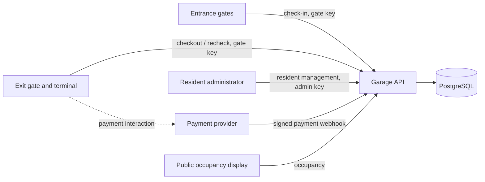
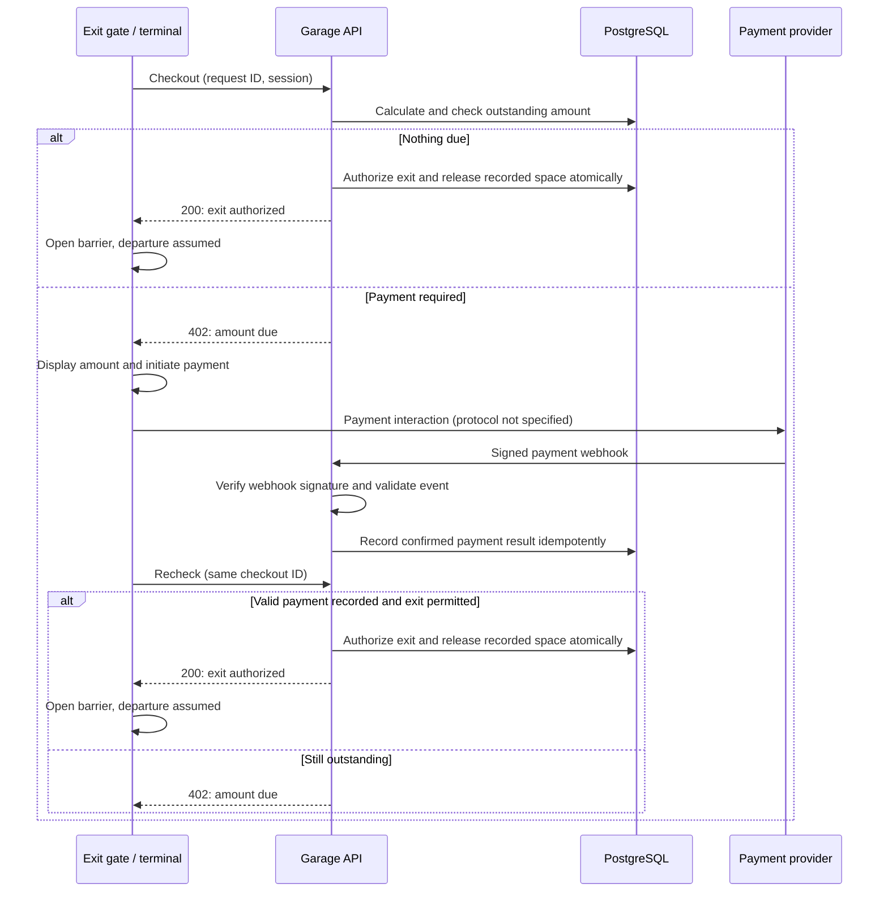

# Garage application: pilot architecture

## Status and purpose

This is a cross-feature design for the pilot, not an implementation specification. It records planning decisions alongside assumptions and limitations. Feature specs and README describe the current contract and status; supplied vendor notes remain unchanged.

Sources: [brief](../BRIEF.md), [gate notes](gates.md), [payment provider notes](payment-provider.md), and the [PB-03](../specs/pb-03-check-in.md), [PB-04](../specs/pb-04-check-out.md), [PB-05](../specs/pb-05-payment-confirmation.md) and [PB-06](../specs/pb-06-occupancy.md) specs. The PB-04 retrospective alignment landed in `63551c4`; an independent review focused on replacement and closed-session precedence, not the entire amendment. Setup and operational precautions are in the [README](../README.md).

The current backend implements PB-03 through PB-06 as a pilot, including checkout, signed payment webhook and occupancy; PB-05 landed in `b1ded0c`. The pilot is not production-ready: the vendor assumptions and payment and occupancy limitations below remain deployment blockers. PB-03 review fixes have not had a further independent review. The configured stack is TypeScript, Node 26, Express, PostgreSQL, Drizzle ORM and `pg`, with Vitest and Docker Compose.

**Spec-first checkpoint:** PB-03 through PB-06 each require a reviewed feature spec in `specs/` committed before the corresponding implementation. Ask for explicit authorization before committing. The architecture does not replace those specs; substantive changes to a feature spec also need the spec-first checkpoint.

## Context and boundaries

The brief specifies pilot building `PB-AMS-2M8D`, two entrance gates, two exit gates, a public occupancy display and a payment provider. Future buildings may have different layouts and tariffs. Support for multiple buildings and their administration is not implied by accommodating building-specific data.

The final payment-interaction connection is illustrative: the supplied material does not specify the terminal-to-provider protocol. The gate calls only the garage system for the parking and exit decision. The payment provider sends its result to the garage system, not to the gate through an assumed integration.

### Responsibilities

One modular application is recommended, with boundaries around:

- **API and security:** request validation, gate/admin authentication, raw-body webhook verification and HTTP responses.
- **Resident registry:** plate registration and removal, administrative listing, capacity and resident eligibility.
- **Parking:** space allocation, session lifecycle and exit authorization.
- **Pricing:** elapsed-time started hours, Amsterdam calendar-day caps and amounts due.
- **Payments:** provider confirmations, attempt identity, deduplication and recorded amounts paid.
- **Occupancy:** public space status without plates or other unnecessary private information.
- **Persistence:** transactional state and database-enforced safety where applicable.

These are logical responsibilities, not mandated services or directory layout. PostgreSQL is the shared source of truth. No message broker or separate payment service is required by this design.

## Pilot layout and eligibility

| Spaces | Floor | Eligibility | Tariff |
| --- | --- | --- | --- |
| 1–50 | 1 | Registered residents, car or motorcycle | Free |
| 51–75 | 1 | Visitor cars | €5 per started hour, €30 daily cap |
| 76–130 | 2 | Visitor cars | €5 per started hour, €30 daily cap |
| 131–150 | 2 | Visitor motorcycles | €3 per started hour, €18 daily cap |

The pilot registry holds at most 50 registered plates. Normalize case and remove spaces and dashes, so `AB-123-C`, `ab123c` and `AB 123 C` match. Exact allowed characters and validation limits remain for the feature spec.

The check-in response's `parkingSpaceId` is the physical space number from this table; it is selected by the application, not supplied by the gate. Space number, building, floor and eligibility are stored as data. Numbers are unique within a building, and future buildings need not follow the pilot's numbering/category ranges.

| Registered plate? | Driver selection | Outcome |
| --- | --- | --- |
| Yes | Resident or visitor | Free resident space, for either vehicle type |
| No | Resident | Reject the claim; driver can correct the plate or retry as a visitor |
| No | Visitor | Paid space for the vehicle type |

Reject a second active session for the same normalized plate. The session's actual category is determined at check-in: adding a plate to the registry later does not make an existing visitor session free. This is a deliberate simplification and limitation. Checkout's required `isResident` field is non-authoritative: a mismatch does not change the recorded category or reject checkout. The registry contains no resident profile, but licence plates can still be personal data and require protection.

An admin API, protected with its own generated key, registers and removes plates and lists registered plates per building. Allowed building codes and registration limits are configured; a database building record is initialized for the pilot, `PB-AMS-2M8D`, with capacity 50. There is no building-management API yet. Allowing a building's code for registry administration does not establish check-in support, its layout or its tariff. Prevent removal during an active resident session. The limit, active-session rule and allocation must remain correct under concurrent requests. Together these rules protect *recorded* resident capacity, not physical availability: the exit approximation below can diverge from reality. Exact admin routes, capacity enforcement and error behavior are specified in PB-03.

## Check-in and occupancy

An authenticated entrance gate submits the brief's check-in request with `X-Request-Id`. The system validates it, resolves eligibility, and allocates an eligible space and creates a session atomically. Concurrent successful requests must never allocate the same space; protect this with PostgreSQL-enforced invariants and appropriate transactions, not only in-memory locks. A retry of a successful check-in must not allocate another space.

Each check-in attempt has a 1,500 ms application processing budget, measured from receipt. The gate waits two seconds before retrying, so the remaining nominal 500 ms allows response travel; it is not a delivery guarantee. A committed response can still be lost or go unacted upon, and an operator may have to investigate a potentially orphaned session. A safe deployment requires the gate to correlate responses with the current vehicle event, including ignoring old responses: the supplied notes do not confirm this capability. Building configuration changes require all instances to stop for a coordinated database/configuration update and restart.

On timeout the attempt closes its acquired connection and suppresses a late success response. A COMMIT already sent can have an unknown outcome; retry the same gate request ID to recover the durable result. Timers cannot guarantee scheduling or network delivery. Admin transactions also have a 1,500 ms deadline, but have no gate request ID: inspect the registry before retrying an uncertain COMMIT.

Occupancy is publicly readable and reflects **recorded allocation**. It does not disclose plates or payment information; PB-06 specifies category and vehicle eligibility. On exit authorization, the system releases the recorded space, assuming the vehicle leaves. It cannot verify that the barrier actually opened or the vehicle departed; actual occupancy can therefore differ.

## Exit and payment flow

The brief and gate notes do not fully specify how a gate receives an asynchronous payment result. For this pilot, the following is an **assumed gate contract**, not a confirmed vendor capability:

- The gate is the terminal/controller; the barrier is the physical mechanism. A `200` exit authorization causes the gate to open the barrier.
- The gate can handle `402 Payment Required`, display the outstanding amount and initiate payment. The brief instead illustrates a `200` checkout response with the amount; this is an intentional proposed contract difference.
- The payment terminal is part of the gate equipment and can recheck the garage API after a `402`, including after the original timeout retries are exhausted. An interaction is not itself proof of payment.
- Rechecks for the same checkout interaction reuse its request ID and body until `200`. The ID may move from `402` to `200` after valid confirmation; it is not an immutable replay of the first `402`. The pilot assumes a new request ID after grace expires without authorization, or for a later interaction after abandonment; a new ID recalculates. How the gate learns grace timing is unverified. Provider payment IDs are separate and deduplicate payment attempts.
- Repeated `402`s for the same quote do not automatically initiate another payment; the driver can retry after a failed attempt. A new quote for an additional balance can initiate another payment. The backend does not know a payment is in progress; terminal behavior is an unverified pilot assumption.
- If a recheck precedes provider confirmation, the gate must be able to recheck again. Exact trigger and timing require vendor agreement.

Webhook and gate recheck can arrive in either order; a recheck before confirmation stays pending. The gate notes promise timeout retries with the same ID after a two-second wait, up to three retries; they do not establish retries after a received `402`, a specific total retry duration, or a payment-triggered request. A short retry period is a gate limitation, not a substitute for the assumed later recheck.

An exit authorization and space release must be atomic. Once authorized, repeated successful requests must not release another allocation or mutate the session again. The missing physical gate-open/departure confirmation is an occupancy-integrity weakness; an authenticated departure event is a recommended future vendor integration. The present pilot knowingly releases earlier.

## Pricing and grace period

The brief's €8.33 example for a car parked 09:00–10:40 conflicts with its €5-per-started-hour rule. The agreed choice is **started hours, not prorated usage**: the example costs €10. Resident sessions are free. Amounts use integer cents, not floating-point money.

Chargeable hour blocks are anchored to check-in, measured in actual elapsed time, and attributed to the Amsterdam local calendar day on which each block starts. Apply the applicable daily cap to the blocks attributed to that day. Midnight does not start a new block. Store instants and use the building's time zone to determine local dates; daylight-saving jumps and repeated clock hours do not change actual elapsed duration.

| Car stay | Started-hour charge before caps |
| --- | --- |
| Zero elapsed time | €0 |
| 09:00–10:00 | €5 |
| 09:00–10:00:01 | €10 |
| 23:45–00:00 | €5, attributed to the first day |
| 23:45–00:45 | €5, attributed to the first day |
| 23:45–00:45:01 | €10: first block attributed to day 1, second to day 2 |

The 15-minute exit window begins when our system first records a valid successful payment confirmation, using server time; duplicate delivery cannot extend it. The provider body contains no payment timestamp, so delayed delivery can give the customer extra time after actual payment. The user accepts this service-provider risk. If the window expires, recalculate the charge and subtract successfully recorded payments. If nothing further is due, authorize exit; otherwise require the difference. A new successful additional payment starts a new window. Free resident sessions can exit without a payment window.

The grace window is inclusive at its start and exclusive at its end. Checkout evaluates session payments; after grace it recalculates or retains an uncovered current quote. A later payable request replaces the earlier current amount; a superseded retry on an active session returns `409 CHECKOUT_SUPERSEDED`. After closure, `EVENT_CLOSED` takes precedence over supersession, except that a committed `200` replays. PB-05 validates the current balance without a quote ID; ambiguous late confirmations remain an accepted pilot limitation, not a solved attribution workflow. Once exit is authorized, an actual delayed departure cannot be detected.

Reported session minutes are elapsed whole minutes rounded down, independently of billing. The tariff is fixed by the category recorded at check-in; checkout's `isResident` cannot change it. Pricing is implemented in [`pricing.ts`](../garage/src/parking/helpers/pricing.ts).

## Checkout replacement and payment attribution

An unpaid current quote remains fixed across tariff increases until covered or replaced. For example, if checkout A displays EUR 5 and a later payable checkout B displays EUR 10, B replaces A; a matching retry of A on an active session returns `409 CHECKOUT_SUPERSEDED`, not EUR 5. After closure a non-successful binding returns `409 EVENT_CLOSED`; a committed `200` still replays, and changed-body conflict takes precedence. A top-up can also become current on an existing unsuperseded request. Handling these responses and abandoning old interactions are accepted pilot assumptions, not confirmed gate capabilities.

PostgreSQL enforces at most one current request per session. Checkout and payment recording use the shared building lock; a successful payment consumes the current request. The request stores the session paid total at issuance, so a later increase indicates ordinary coverage, not attribution of a payment to a quote. A new `PAID` event must match the full current outstanding amount on an active session. The webhook records payment but never releases a space; checkout authorizes release.

The accepted pilot assumes near-instant provider delivery and no duplicate successful charge for a balance. Neither is guaranteed by the provider notes, which allow retries for 24 hours. Without a quote ID or payment timestamp, a delayed old payment equal to the new balance can be accepted as if it were current; a mismatching signed confirmation is rejected and logged even if the external charge already occurred. Operators must investigate manually: diagnostics neither reconcile nor refund charges. There is no payment-start signal or automatic abandonment detection, and no safe attribution workflow for delayed or renewed quotes. Confirm provider and gate operations before deployment.

## Authentication, retries and failure boundaries

- Use distinct generated keys per gate, with entrance-only or exit-only permissions, and a separate resident-admin key. Protect keys and payment secrets in configuration, use HTTPS for gate traffic, and never commit secrets. Exact provisioning and rotation are spec tasks.
- The webhook accepts valid HMAC-SHA256 signatures over the **raw request bytes**, as required by the provider notes. Reject missing or invalid signatures. Unsigned legacy calls carrying `X-Terminal-Compat: 1` are rejected: the header is not authentication. This deliberately leaves legacy terminals unsupported until a firmware upgrade or separately authenticated channel is agreed.
- Gate request IDs and bodies are tracked durably for overlapping retries. Conflicting reuse with a different body is rejected; a pending checkout may change from `402` to `200`, but an already successful side effect must not repeat. The feature specs define scope, retention, error bodies and recovery.
- The provider uses one `paymentId` per attempt and delivers at least once, potentially out of order. Deduplicate identical successful deliveries, including after checkout; conflicting reuse must not silently change a payment. Failed events for known sessions are logged without persistence and must not undo a prior success. PB-05 specifies validation, responses and manual investigation of suspicious events.
- A session may have multiple successful payment IDs for different outstanding amounts, such as the initial payment and a later additional charge. The pilot assumes the provider will not successfully charge the same outstanding balance twice. Refunds and payment resolution are outside this application; unexpected/conflicting confirmations must not be silently counted as valid payment.
- When necessary state or dependencies are unavailable, do not authorize exit or allocate a space without establishing the relevant invariants. Specific failure responses and operational recovery remain to be specified.

## Remaining design and verification work

**Completed evidence:** PB-03–PB-06 specs and pilot implementations have landed; the PB-04 alignment was committed in `63551c4`. The journal records a focused independent review of replacement and closed-session precedence, not a comprehensive amendment review. It also records a developer-run unfiltered suite on a fresh isolated PostgreSQL server: 20 files and 111 tests passed with the simulator enabled. The landed PB-05 independent rereview did not rerun database tests or the simulator; this historical developer run is not independent verification or vendor confirmation.

**Outstanding:**

1. Confirm the accepted pilot gate assumptions with the vendor before real deployment, including `402` handling, display, recheck trigger, timing, response correlation, and the absence or future availability of a departure event. Determine how a separate terminal triggers a recheck.
2. Independently review outstanding PB-03 fixes and assess operational readiness of resident administration and allocation. Consider a comprehensive review of the PB-04 amendment beyond the focused precedence review.
3. Independently verify relevant PostgreSQL behavior on a verified isolated test target, including replacement and payment races; assess remaining coverage and deployment risks rather than treating the historical suite as an independent rerun. Delayed-payment attribution and physical departure remain unresolved limitations.

**Ongoing process:** Maintain feature specs alongside behavior and honor the spec-before-implementation commit checkpoint for future substantive changes. This document does not authorize implementation of unspecified behavior.
